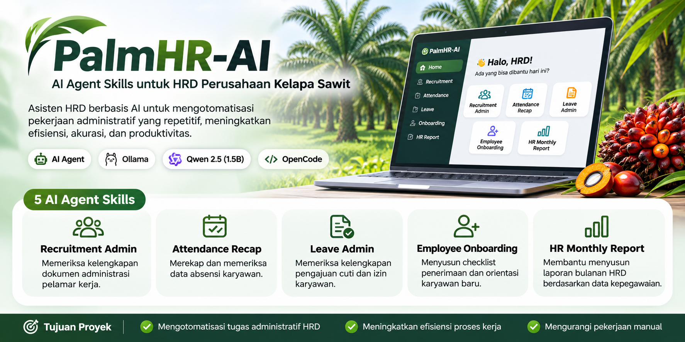
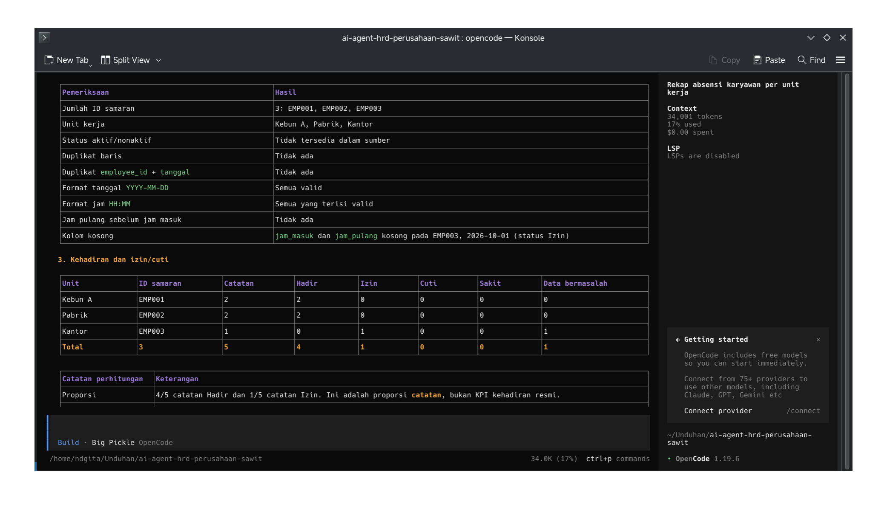

<p align="center">
  
</p>

## Project Preview

<p align="center">
  
</p>

# PalmHR AI — AI Agent Skills untuk HRD Perusahaan Kelapa Sawit# PalmHR AI — AI Agent Skills untuk HRD Perusahaan Kelapa Sawit

PalmHR AI adalah prototipe kumpulan AI Agent Skills untuk membantu pekerjaan administratif HRD pada perusahaan perkebunan kelapa sawit. Proyek ini dirancang untuk dijalankan secara lokal menggunakan **Ollama + OpenCode**.


## Tujuan proyek
Mengurangi pekerjaan administratif yang repetitif, mempercepat pemeriksaan data, dan membantu penyusunan draf laporan. AI berperan sebagai asisten, bukan pengambil keputusan kepegawaian.

## Jobdesk dan aktivitas repetitif

| Jobdesk HRD | Aktivitas berulang | Bantuan AI Agent |
|---|---|---|
| Administrasi rekrutmen | Memeriksa kelengkapan CV dan dokumen | Checklist dan ringkasan administrasi pelamar |
| Administrasi absensi | Menggabungkan catatan kehadiran dan mencari anomali | Rekap per karyawan/unit dan daftar pengecualian |
| Administrasi cuti/izin | Memeriksa formulir dan dokumen pendukung | Pemeriksaan kelengkapan dan draf rekap |
| Onboarding | Menyiapkan daftar dokumen dan orientasi | Checklist berdasarkan jabatan/unit |
| Pelaporan HRD | Menggabungkan data dan menulis laporan rutin | Draf laporan bulanan berbasis data |

## Lima skills

1. `recruitment-admin` — pemeriksaan administrasi pelamar.
2. `attendance-recap` — rekap absensi dan deteksi anomali.
3. `leave-admin` — pemeriksaan administrasi cuti/izin.
4. `employee-onboarding` — checklist penerimaan karyawan.
5. `hr-monthly-report` — draf laporan bulanan HRD.

## Struktur repository

```text
PalmHR-AI/
├── README.md
├── .gitignore
├── skills/                 # sumber utama lima SKILL.md
├── .opencode/skills/       # salinan agar dapat langsung dibaca OpenCode
├── examples/               # data uji fiktif
└── testing/                # skenario, prompt, dan kriteria evaluasi
```

## Persyaratan
- Linux (contoh: CachyOS/Arch-based).
- Ollama.
- Model lokal yang kompatibel, misalnya `qwen2.5:1.5b`.
- OpenCode.

Model 1.5B dipilih sebagai titik awal untuk perangkat dengan memori terbatas. Kualitas hasil dapat berbeda; periksa setiap keluaran sebelum digunakan.

## Instalasi dan menjalankan

### 1. Unduh model lokal
```bash
ollama pull qwen2.5:1.5b
```

### 2. Masuk ke folder repository
```bash
cd PalmHR-AI
```

### 3. Salin skills ke direktori OpenCode
Repository ini sudah menyertakan `.opencode/skills/`. Jika perlu membuat ulang salinannya:
```bash
mkdir -p .opencode/skills
cp -r skills/* .opencode/skills/
```

### 4. Jalankan OpenCode
Pastikan Ollama berjalan, lalu:
```bash
opencode
```

### 5. Uji agent
Gunakan prompt di folder `testing/`. Contoh:
```text
Baca dan ikuti skill attendance-recap.
Analisis examples/data_karyawan_fiktif.csv.
Rekap kehadiran per unit, tandai data kosong/duplikat/anomali,
dan jangan mengubah file sumber.
```

## Hasil pengujian
Kelima skill berhasil dijalankan melalui OpenCode:
- Recruitment Agent
- Attendance Agent
- Leave Management Agent
- Employee Onboarding Agent
- HR Reporting Agent

Satu contoh keluaran Attendance Agent tercatat dalam percakapan pengembangan: 5 catatan, 4 hadir, 1 izin; EMP003 ditandai untuk verifikasi karena jam masuk/pulang kosong. Keterlambatan/lembur tidak dihitung karena aturan shift dan toleransi tidak disediakan.


## Privasi, keamanan, dan batasan
- Gunakan data fiktif atau anonim untuk demonstrasi.
- Jangan memasukkan NIK, alamat, nomor rekening, nomor telepon, dokumen identitas, atau data kesehatan ke layanan AI yang tidak disetujui perusahaan.
- Jangan gunakan keluaran model sebagai satu-satunya dasar keputusan ketenagakerjaan.
- AI tidak boleh otomatis menerima/menolak kandidat, menyetujui cuti, memberi sanksi, menetapkan promosi, atau memutus hubungan kerja.
- Jangan mengarang kebijakan, saldo cuti, jam kerja, aturan lembur, atau persyaratan rekrutmen.
- Semua hasil harus diverifikasi petugas HRD sesuai kebijakan perusahaan dan peraturan yang berlaku.

## Lisensi
Materi proyek ini disediakan untuk pembelajaran dan demonstrasi. Sesuaikan dengan kebutuhan dan kebijakan organisasi sebelum penggunaan operasional.
